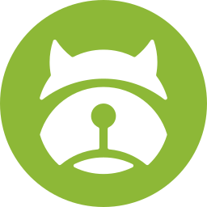
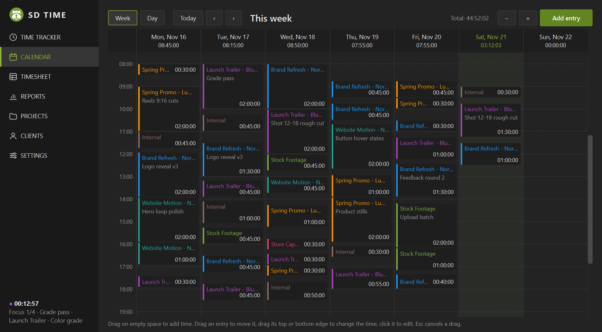
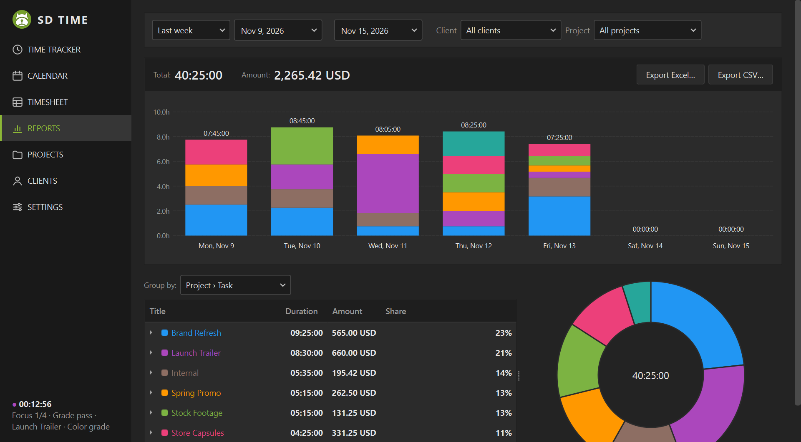
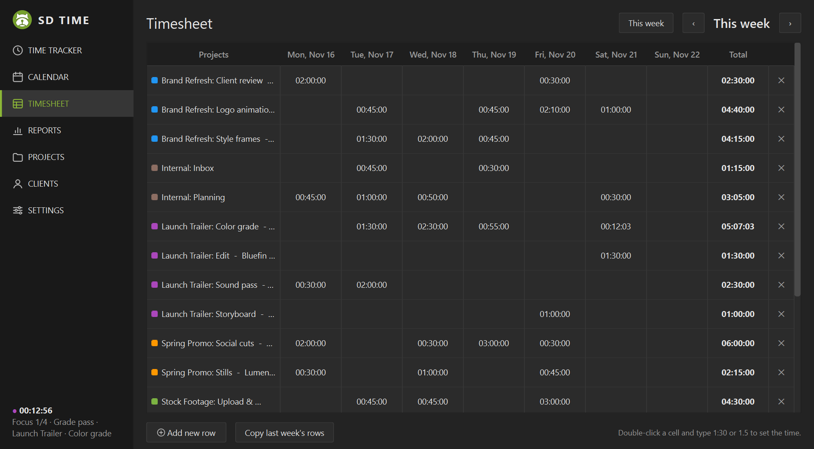
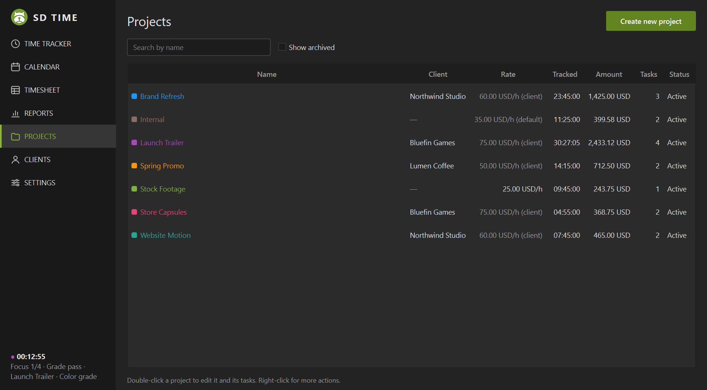
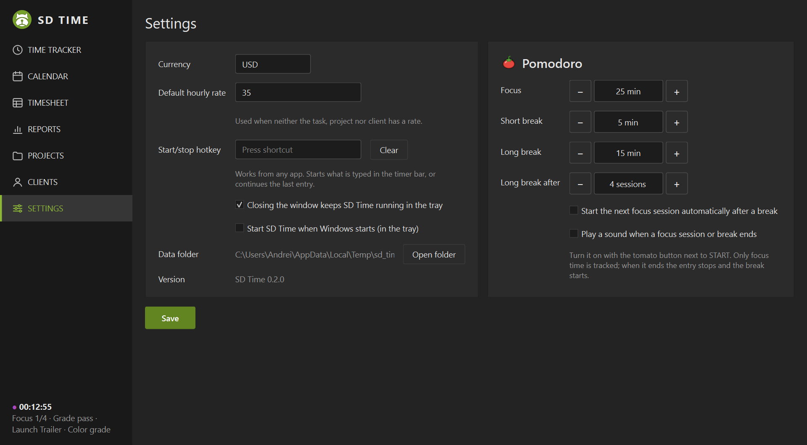

<p align="center">
  
</p>

<h1 align="center">SD Time</h1>

<p align="center">
  <b>A calm desktop time tracker for Windows.</b><br>
  Tray timer, clients → projects → tasks, hourly rates, calendar, timesheet, reports and a Pomodoro mode.<br>
  Everything stays on your computer.
</p>

<p align="center">
  <a href="../../releases/latest"></a>
  
  
</p>

<p align="center">
  
</p>

> Screenshots use made-up demo data.

---

## Features

**Track**
- **One-click timer** in the app and in the system tray, plus a **global hotkey** (`Ctrl+Alt+T`) that works from any program.
- **Autocomplete** from earlier entries — picking one also fills in its project and task.
- Entries grouped by **week and day** with totals and earnings; edit inline, continue, duplicate, delete, or add time manually.
- Accidental start/stop clicks (under 5 seconds) are not saved.

**Organise and bill**
- **Clients → projects → tasks**; client and task are optional.
- **Hourly rates** inherited task → project → client → default, with amounts everywhere.
- Archive instead of delete; deleting keeps your time entries.

**See where the time went**
- **Calendar** week / day view — drag to create entries, drag to move them, drag an edge to resize.
- **Timesheet** — a week grid; type `1:30` or `1.5` into a cell.
- **Reports** — stacked bars by day, grouped totals, donut chart, **Excel and CSV export**.

**Focus**
- **Pomodoro mode** — focus countdown, a chime, then *take a break or keep working?* Only focus time is tracked. Long break every 4 sessions; all lengths configurable.

**Feels at home on Windows**
- Real installer, Start menu shortcut, optional **start with Windows**, lives quietly in the tray.
- Dark grey theme with an olive-green accent.

## Screenshots

| Calendar | Reports |
|---|---|
|  |  |
| **Timesheet** | **Projects** |
|  |  |
| **Pomodoro** | **Settings** |
|  |  |

## Install

1. Download **`SD_Time_Setup_<version>.exe`** from [Releases](../../releases/latest).
2. Run it. No admin rights needed — it installs for the current user.
3. Optionally tick *desktop shortcut* and *start with Windows*.

Running a newer installer updates in place. Uninstall from **Settings → Apps**; you'll be asked whether to keep your data (the default is to keep it).

## Your data

Everything is stored locally in `%APPDATA%\SD_Time` — a single SQLite database plus a settings file.
Nothing is sent anywhere. To back up, copy that folder.

## Tips

| | |
|---|---|
| Start / stop from anywhere | `Ctrl+Alt+T` (change it in Settings) |
| Show / hide the window | left-click the tray icon |
| Quick actions | right-click the tray icon |
| Continue a past activity | ▷ on its row, or *Continue* in the tray menu |
| Fix a forgotten timer | drag its block in the Calendar, or click the time range |

## Build from source

Requires Windows and Python 3.12+.

```powershell
python -m venv .venv
.\.venv\Scripts\python.exe -m pip install -r requirements.txt
.\SD_Time.bat                      # run from source
```

Installer build (needs [Inno Setup 6](https://jrsoftware.org/isinfo.php): `winget install JRSoftware.InnoSetup`):

```powershell
.\.venv\Scripts\python.exe -m pip install -r requirements-tools.txt
.\build.ps1                        # -> dist\SD_Time_Setup_<version>.exe
```

`build.ps1` builds a standalone app with PyInstaller, runs it in self-test mode, then packs the installer.

Tests: `.\.venv\Scripts\python.exe -m unittest discover -s tests`

Screenshots for this page: `.\.venv\Scripts\python.exe tools\make_screenshots.py`

<details>
<summary>Project layout</summary>

```
sd_time/            app package
  db.py             SQLite storage, migrations, rates
  main_window.py    window, tray, hotkey, Pomodoro controller
  pages/            tracker, calendar, timesheet, reports, projects/clients/settings
  pomodoro.py       Pomodoro state machine
  theme.py          colours and stylesheet
  icons.py          logo and line icons
assets/             logo (SVG/ICO) and UI images
packaging/          PyInstaller spec, Inno Setup script
tools/              logo, icon and screenshot generators
tests/              unit tests
```
</details>

## Versions

See [CHANGELOG.md](CHANGELOG.md). The version lives in `sd_time/__init__.py`; releases are tagged `vMAJOR.MINOR.PATCH`.

## License

Not licensed for redistribution yet — all rights reserved.
