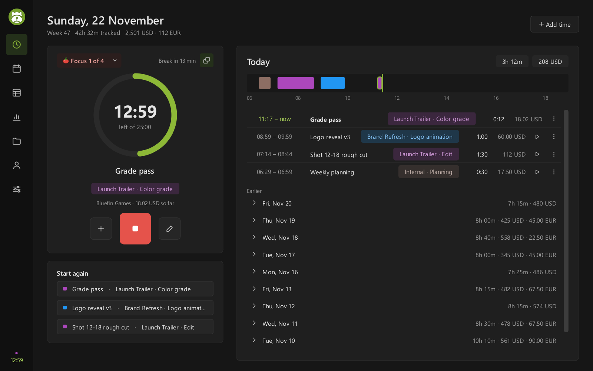
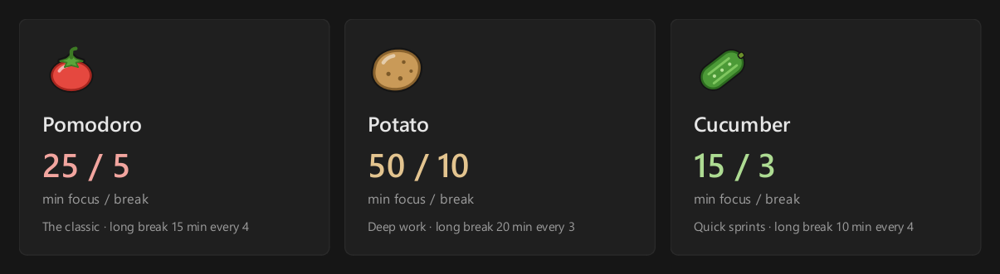
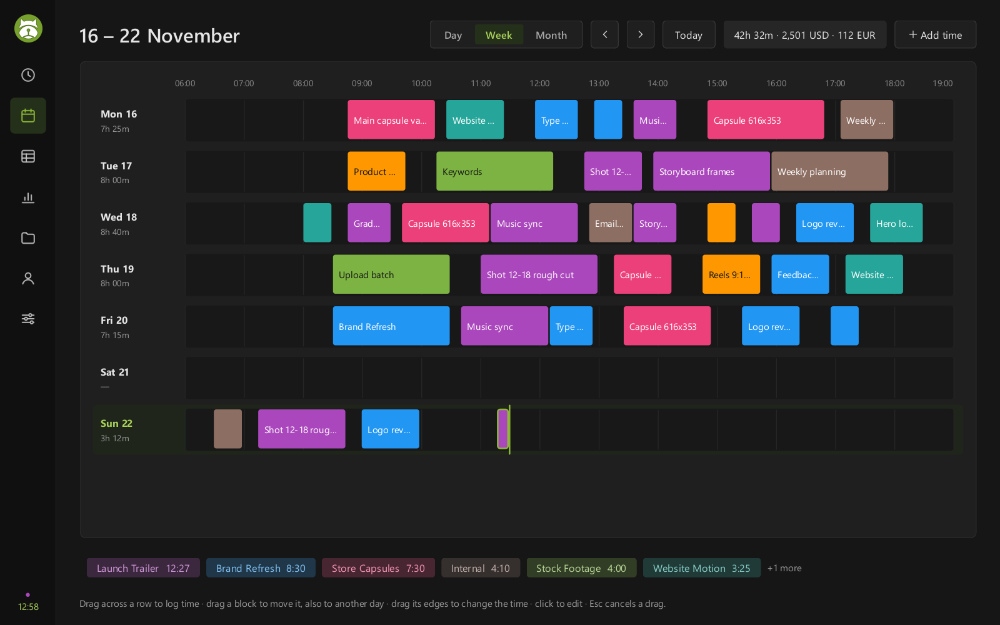
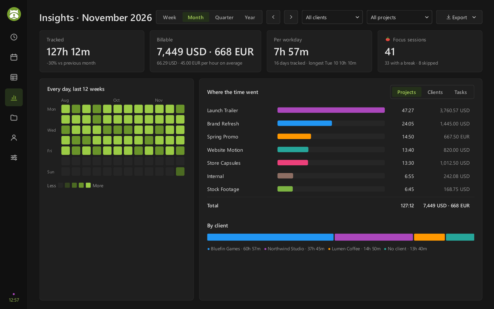
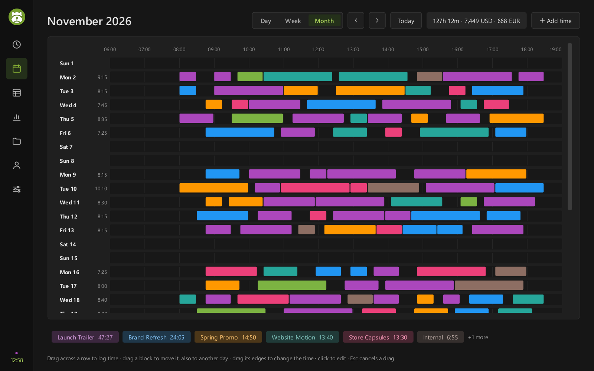
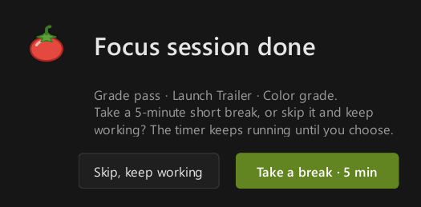
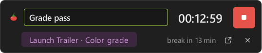

<p align="center">
  
</p>

<h1 align="center">SD Time</h1>

<p align="center">
  <b>A calm desktop time tracker for Windows.</b><br>
  Tray timer, clients → projects → tasks, hourly rates, calendar, timesheet and insights,<br>
  plus a focus timer in three flavours: 🍅 tomato, 🥔 potato and 🥒 cucumber.<br>
  Everything stays on your computer.
</p>

<p align="center">
  <a href="../../releases/latest"></a>
  
  
  <a href="LICENSE"></a>
</p>

<p align="center">
  
</p>

> Screenshots use made-up demo data.

## 🍅 🥔 🥒 Pick your focus timer

A Pomodoro timer is good, but not every task fits 25 minutes. SD Time has three:

<p align="center">
  
</p>

| | Focus / break | Long break | Good for |
|---|---|---|---|
| 🍅 **Pomodoro** | 25 / 5 min | 15 min every 4 sessions | everyday work, the classic rhythm |
| 🥔 **Potato** | 50 / 10 min | 20 min every 3 sessions | deep work: editing, coding, writing |
| 🥒 **Cucumber** | 15 / 3 min | 10 min every 4 sessions | quick sprints, inbox, small fixes |

Switch with one click on the chip above the timer ring. Each flavour counts down, chimes, and asks
*take a break or keep working?* Only focus time is tracked. Every flavour keeps its own lengths:
make your potato 45 minutes or your cucumber 10 in **Settings → Focus timer**.

---

## Features

**Track**
- **A ring timer** that doubles as Pomodoro progress, one big start/stop button, and a **global hotkey** (`Ctrl+Alt+T`) that works from any program.
- **Mini timer** — a small window that stays on top of other programs: what you're doing, project and task, the time and START/STOP. Drag it anywhere; it remembers its place. Open it with `Ctrl+Alt+M`, the tray menu or the two-windows button on the timer card.
- **Start again** with one click on your recent activities; **autocomplete** fills in project and task.
- **Today** as a time ribbon plus compact lines; earlier days fold into one line each and open on click.
- Accidental start/stop clicks (under 5 seconds) are not saved.

**Organise and bill**
- **Clients → projects → tasks**; client and task are optional. The Projects page lists every
  project with its tasks underneath (own rate, tracked time, amount) and an *Add task* row.
- **Hourly rates** inherited task → project → client → default, with amounts everywhere. **Several currencies**: list the ones you bill in (Settings → Currencies) and pick one next to each rate; totals show each currency separately, never converted.
- Archive instead of delete; deleting keeps your time entries.

**See where the time went**
- **Week** — days are rows and hours run left to right (also Day and Month). Drag to log time, drag a block to move it to another time or day, drag its edges to resize.
- **Timesheet** — a week ledger of pills; type `1:30` or `1.5`. A **gap finder** spots untracked time between entries and fills it in one click.
- **Insights** — tracked, billable, per-workday and focus-session numbers, a 12-week heatmap, ranked projects / clients / tasks, a by-client strip, **Excel and CSV export**.

**Focus**
- **Focus timer in three flavours** — 🍅 *Pomodoro* (25 / 5), 🥔 *Potato* for deep work (50 / 10) and 🥒 *Cucumber* for quick sprints (15 / 3). Pick one from the chip above the ring. Each counts down, chimes, then asks *take a break or keep working?* Only focus time is tracked; sessions are counted in Insights. Every flavour keeps its own lengths, all configurable in Settings.

**Feels at home on Windows**
- Real installer, Start menu shortcut, optional **start with Windows**, lives quietly in the tray.
- Dark theme with an olive-green accent, icon rail, flat cards and one control height.

## Screenshots

| Week | Insights |
|---|---|
|  |  |
| **Timesheet with gap finder** | **Month** |
|  |  |
| **Projects** | **Pomodoro** |
|  |  |
| **Mini timer** | |
|  | |

## Install

1. Download **`SD_Time_Setup_<version>.exe`** from [Releases](../../releases/latest).
2. Run it. No admin rights needed — it installs for the current user.
3. Optionally tick *desktop shortcut* and *start with Windows*.

Running a newer installer updates in place. Uninstall from **Settings → Apps**; you'll be asked whether to keep your data (the default is to keep it).

## Your data

Everything is stored locally in `%APPDATA%\SD_Time` — a single SQLite database plus a settings file.
Your data is never sent anywhere. To back up, copy that folder.

**Update check.** Once a day SD Time asks GitHub for the number of the latest release (nothing else is sent). If there is a newer one, a tray notification links to its download page; nothing is installed on its own. Turn it off in **Settings → About**, or check by hand there.

## Tips

| | |
|---|---|
| Start / stop from anywhere | `Ctrl+Alt+T` (change it in Settings) |
| Show / hide the window | left-click the tray icon |
| Mini timer on top | `Ctrl+Alt+M`, *Mini timer* in the tray menu, or the two-windows button on the timer card |
| Quick actions | right-click the tray icon |
| Continue a past activity | *Start again* card, ▷ on its row, or *Continue* in the tray menu |
| Fix a forgotten timer | drag its block in Week, or click the time range |
| Fill untracked time | the gap finder on the Timesheet page |

## Build from source

Requires Windows and Python 3.12+.

```powershell
python -m venv .venv
.\.venv\Scripts\python.exe -m pip install -r requirements.txt
.\SD_Time.bat                      # run from source
```

Installer build (needs [Inno Setup 6](https://jrsoftware.org/isinfo.php): `winget install JRSoftware.InnoSetup`):

```powershell
.\.venv\Scripts\python.exe -m pip install -r requirements-tools.txt
.\build.ps1                        # -> dist\SD_Time_Setup_<version>.exe
```

`build.ps1` builds a standalone app with PyInstaller, runs it in self-test mode, then packs the installer.

Tests: `.\.venv\Scripts\python.exe -m unittest discover -s tests`

Screenshots for this page: `.\.venv\Scripts\python.exe tools\make_screenshots.py`

<details>
<summary>Project layout</summary>

```
sd_time/            app package
  db.py             SQLite storage, migrations, rates
  main_window.py    window, tray, hotkey, Pomodoro controller
  mini.py           mini timer (small always-on-top window)
  pages/            today (tracker), week, ledger (timesheet), insights, manage
  pomodoro.py       Pomodoro state machine
  theme.py          colours and stylesheet
  icons.py          logo and line icons
assets/             logo (SVG/ICO) and UI images
packaging/          PyInstaller spec, Inno Setup script
tools/              logo, icon and screenshot generators
tests/              unit tests
```
</details>

## Versions

See [CHANGELOG.md](CHANGELOG.md). The version lives in `sd_time/__init__.py`; releases are tagged `vMAJOR.MINOR.PATCH`.

## License

[MIT](LICENSE): use it, change it, share it, just keep the copyright notice.

SD Time is built with [Qt for Python (PySide6)](https://doc.qt.io/qtforpython-6/), licensed under the
[LGPL v3](https://www.gnu.org/licenses/lgpl-3.0.html), and [openpyxl](https://openpyxl.readthedocs.io/)
(MIT). The installer ships the unmodified Qt libraries as separate files, so they can be replaced.
